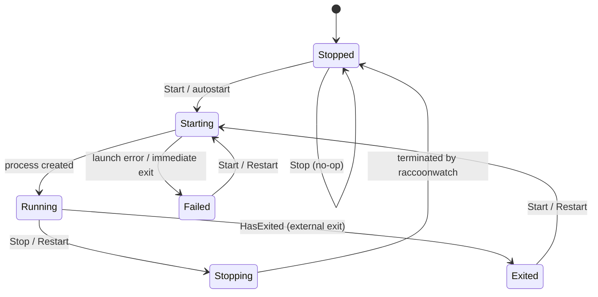

# raccoonwatch — Data Model and State Machine (Phase 0)

Version: 1.0
Status: Approved — reflects the implemented data model.

## 1. Domain types

### 1.1 `ProcessKind` (enum)

| Value | Meaning | Launcher |
|---|---|---|
| `Executable` | Native executable | command path used directly |
| `Cmd` | Windows command script (`.cmd`, `.bat`) | `cmd.exe /c "<path> [args]"` |
| `PowerShell` | PowerShell script (`.ps1`) | `powershell.exe -NoProfile -ExecutionPolicy Bypass -File "<path>" [args]` |

### 1.2 `ProcessStatus` (enum)

`Unknown`, `Stopped`, `Starting`, `Running`, `Stopping`, `Exited`, `Failed`.

### 1.3 `ProcessDefinition` (persisted)

| Property | Type | Required | Constraints / notes |
|---|---|---|---|
| `Id` | `Guid` | yes | Stable identity; generated on add, preserved on edit. |
| `DisplayName` | `string` | yes | Unique (case-insensitive), ≤ 80 chars, shown in tray. |
| `Kind` | `ProcessKind` | yes | Determines launcher and validation. |
| `CommandPath` | `string` | yes | Absolute path to `.exe` / `.cmd` / `.bat` / `.ps1`. |
| `Arguments` | `string` | no | Appended to command; quoted by launcher helper. |
| `WorkingDirectory` | `string` | no | Existing directory; defaults to command file directory. |
| `UpdateCommandPath` | `string` | no | Updater to run from the tray `Update` action (`.exe`, `.cmd`/`.bat`, `.ps1`). |
| `UpdateArguments` | `string` | no | Arguments appended to `UpdateCommandPath`. |
| `StartOrder` | `int` | yes | Ascending order for Start All / autostart. |
| `AutoStartOnLaunch` | `bool` | yes | Start when raccoonwatch starts (FR-8). |
| `Notes` | `string` | no | Free text, not used at runtime. |

### 1.4 `RuntimeState` (in-memory, not persisted)

| Property | Type | Notes |
|---|---|---|
| `DefinitionId` | `Guid` | Links to definition. |
| `Status` | `ProcessStatus` | Current state (see §3). |
| `ProcessId` | `int?` | OS PID while running/starting/stopping. |
| `StartedAt` | `DateTimeOffset?` | When launch succeeded. |
| `ExitedAt` | `DateTimeOffset?` | When process termination was observed. |
| `ExitCode` | `int?` | Populated on `Exited`/`Stopped`/`Failed` where available. |
| `LastError` | `string?` | Launch/stop error or stderr tail on immediate exit. |
| `RestartCount` | `int` | Restarts in the current raccoonwatch session. |

`Uptime` is computed as `DateTimeOffset.Now - StartedAt` while Running.

Status polling is adaptive: `IProcessManager` calls `IPollingIntervalProvider.NotifyActivity()`
on every Start/Stop/Restart. For the following `FastPollWindowMs` the monitor loop uses
`FastPollIntervalMs` instead of `PollIntervalMs`; each further action extends the window.
The provider never returns an interval slower than `PollIntervalMs`, so a misconfigured fast
interval cannot make detection worse. Only durations are stored — the activity deadline is
in-memory and resets when raccoonwatch restarts.

### 1.5 `AppSettings` (persisted)

| Property | Type | Default | Notes |
|---|---|---|---|
| `SchemaVersion` | `int` | `1` | For forward migration. |
| `Processes` | `List<ProcessDefinition>` | `[]` | Ordered by `StartOrder` when used. |
| `PollIntervalMs` | `int` | `2000` | Normal status polling; min 250, max 60,000. |
| `FastPollIntervalMs` | `int` | `250` | Polling interval used briefly after Start/Stop/Restart; min 250, max 60,000. |
| `FastPollWindowMs` | `int` | `120000` | How long fast polling stays active after an action; min 0 (disabled), max 3,600,000. |
| `OutputHistoryLines` | `int` | `5000` | Ring buffer size per process; min 100. |
| `ShowNotifications` | `bool` | `true` | Tray balloon on failures. |
| `LogLevel` | `string` | `"Information"` | Trace/Debug/Information/Warning/Error. |
| `StopProcessesOnExit` | `bool` | `false` | Configurable shutdown behavior (NFR). |
| `StartWithWindowsMirrored` | `bool` | `false` | Reflection of registry state for UI; registry is source of truth. |

### 1.6 Output record (in-memory)

`OutputEntry { DateTimeOffset Timestamp, Guid DefinitionId, bool IsStdError, string Text }`.
Stored in a per-definition ring buffer of `OutputHistoryLines` entries.

## 2. Status state machine



Notes:
- `Starting` and `Stopping` are transient and visible in the tray while the operation
  runs (typically < 5 s).
- `Exited` keeps metadata (exit code/time) until the next start or definition deletion.
- `Failed` keeps `LastError` for display in the tray submenu and logs.

## 3. Settings file (JSON)

Path: `%APPDATA%\raccoonwatch\settings.json`

Example:

```json
{
  "schemaVersion": 1,
  "processes": [
    {
      "id": "3f2504e0-4f89-11d3-9a0c-0305e82c3301",
      "displayName": "API server",
      "kind": "Executable",
      "commandPath": "C:\\tools\\api.exe",
      "arguments": "--port 5000",
      "workingDirectory": "C:\\tools",
      "updateCommandPath": "C:\\tools\\update.ps1",
      "updateArguments": "-Force",
      "startOrder": 1,
      "autoStartOnLaunch": true,
      "notes": "Primary local API"
    },
    {
      "id": "b7e1c95a-0d2e-4f6b-9c13-7d8e0f1a2b34",
      "displayName": "Backup job",
      "kind": "Cmd",
      "commandPath": "C:\\scripts\\backup.cmd",
      "arguments": "",
      "workingDirectory": "",
      "startOrder": 2,
      "autoStartOnLaunch": false,
      "notes": ""
    }
  ],
  "pollIntervalMs": 2000,
  "fastPollIntervalMs": 250,
  "fastPollWindowMs": 120000,
  "outputHistoryLines": 5000,
  "showNotifications": true,
  "logLevel": "Information",
  "stopProcessesOnExit": false,
  "startWithWindowsMirrored": false
}
```

Serialization conventions: camelCase property names, indented, UTF-8 without BOM;
unknown properties ignored for forward compatibility; schema version checked on load.

## 4. External state

| Store | Path / key | Shape |
|---|---|---|
| Windows autostart | `HKCU\Software\Microsoft\Windows\CurrentVersion\Run` | value `raccoonwatch` (REG_SZ) = `"C:\path\to\raccoonwatch.exe"` (quoted) |
| Logs | `%LOCALAPPDATA%\raccoonwatch\logs\raccoonwatch-yyyyMMdd.log` | rolling text |
| Settings backup | `%APPDATA%\raccoonwatch\settings.json.bad` | corrupt file moved here on recovery |

## 5. Invariants

1. A `RuntimeState` exists only for definitions that have been started at least once in
   the current session; otherwise status is `Stopped`.
2. Only one tracked `Process` instance per definition at a time; Start is a no-op while
   status is Starting/Running/Stopping.
3. `ProcessId` is cleared when status becomes `Stopped`; retained for `Exited`/`Failed`
   so the user can see which PID died.
4. Output history is per definition and survives restarts within the session; it is
   not persisted across raccoonwatch restarts.
5. `StartOrder` values need not be contiguous; ties are broken by display name.
